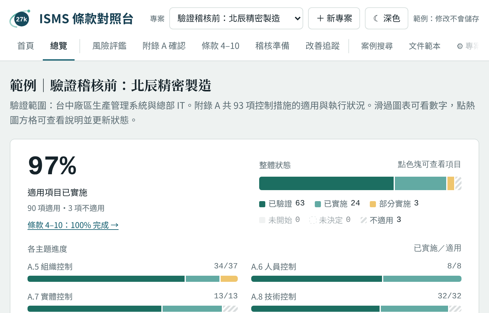
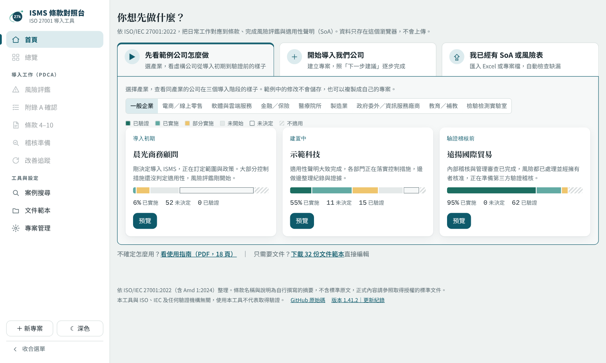
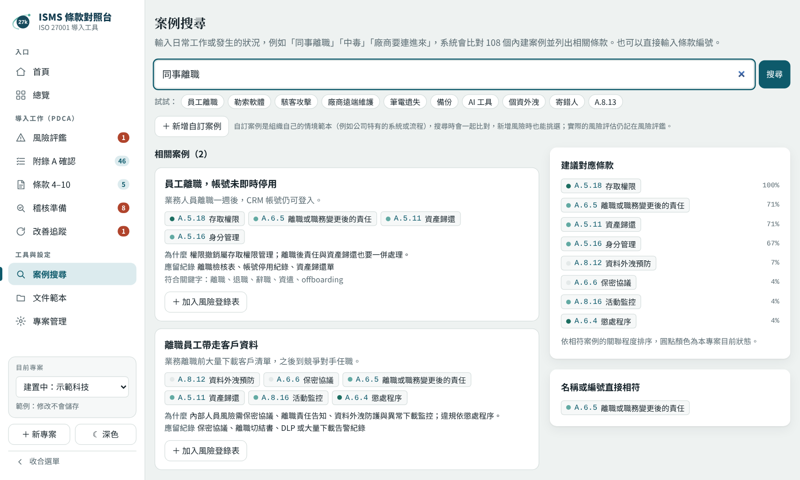
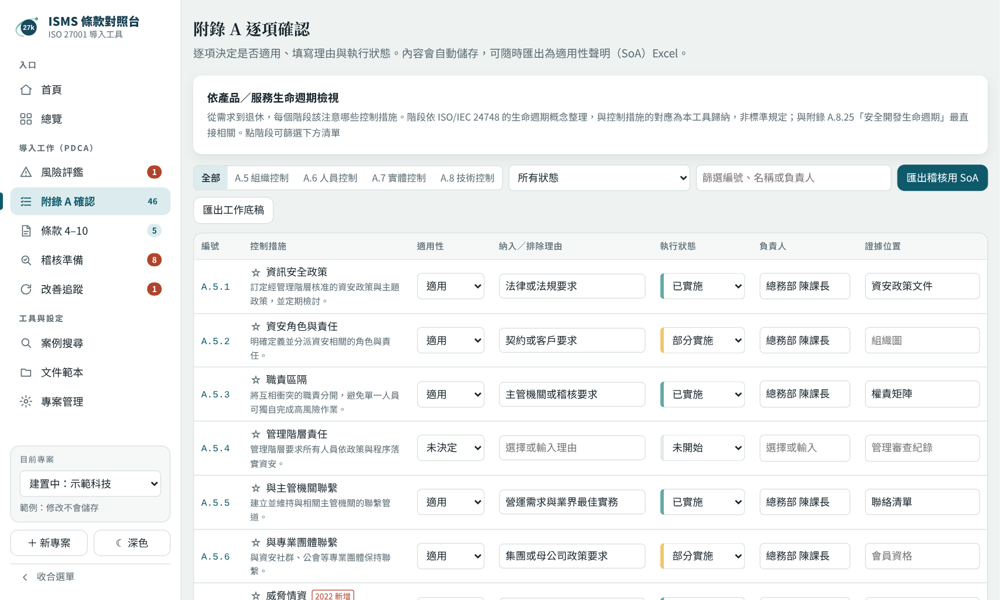
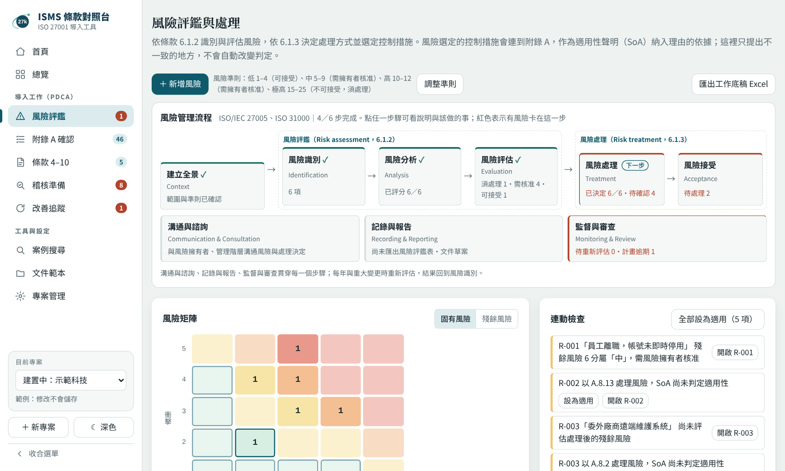
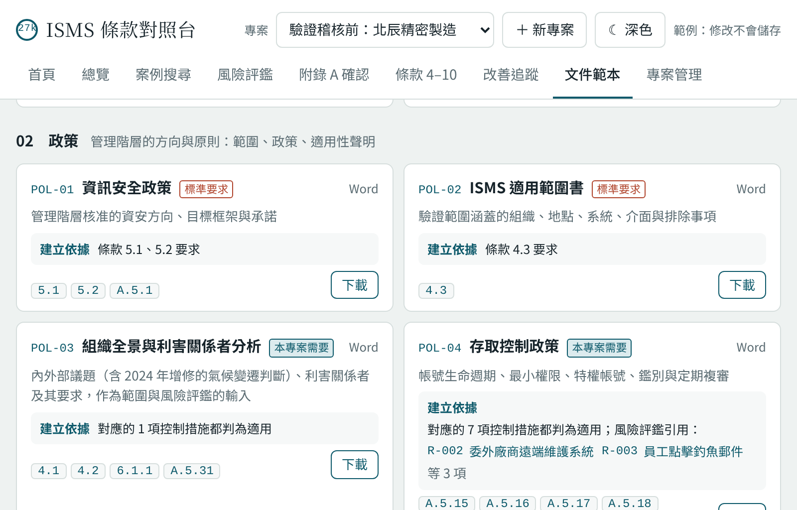

# ISMS 條款對照台

**從工作情境到 SoA 的 ISO 27001 導入工具**

[](https://github.com/coloplay1/isms-mapper/actions/workflows/test.yml)

依 ISO/IEC 27001:2022（含 2024 年氣候變遷增修 Amd 1:2024）架構設計的 ISMS（資訊安全管理系統）導入輔助工具。把日常工作情境對應到條款，登錄並評估風險，依風險結果完成附錄 A 適用性判定，並匯出適用性聲明（SoA）與風險登錄表 Excel。

**線上試用：** https://coloplay1.github.io/isms-mapper/
（開啟後可先預覽首頁的範例專案：8 個產業、各 3 個導入階段，共 24 家虛構公司，不需註冊或安裝）

**使用指南：** [ISMS 條款對照台使用指南（PDF，15 頁）](docs/user-guide.pdf)：依熟悉程度分成第一次導入、已有 Excel 資料、年度維運與顧問三條路線



## 為什麼做這個

導入 ISMS 時最常卡住的，通常不是看不懂條款，而是不知道手上的工作和條款有什麼關係。IT 人員每天做備份、開帳號、更新修補程式，卻不會覺得這是在「做 ISO」。這個工具從實務情境出發，讓人輸入「同事離職」「廠商要遠端連進來」這類描述，就能找到對應的控制措施、對應理由和應留的紀錄。

## 主要功能

| 功能 | 說明 |
|---|---|
| 導入進度與下一步建議 | 總覽上方以 8 個步驟圖示顯示導入進度（範圍 → 準則 → 風險 → SoA → 核准 → 落實 → 稽核 → 改善），依專案資料自動判斷完成與目前步驟，點圓點可看該步驟的狀況與待辦；下方列出最該做的事（逾期、衝突優先），每項附前往按鈕 |
| 案例搜尋 | 內建 103 個實務情境（含 DDoS、暴力破解、商業郵件詐騙、生成式 AI 等攻擊與新興風險）與同義詞字典，輸入「退職」「帳號沒關」「被駭了」也能找到對應條款；可新增組織自己的自訂案例，與內建案例一起搜尋並隨專案檔匯出 |
| 風險評鑑與處理 | 依 6.1.2／6.1.3 登錄風險（資產、威脅、脆弱性、現有控制），5×5 矩陣評估固有與殘餘風險、選擇處理方式與控制措施；可從案例一鍵建立風險，並依描述建議控制措施；上方的風險管理流程圖（ISO/IEC 27005）顯示每一步的進度，點一下篩選卡住的風險 |
| 自訂風險準則 | 2–4 個等級，各自設定分數上限與處理原則（可接受／需擁有者核准／不可接受），內建四級與三級兩種組合，連動檢查依準則判斷是否須處理或核准；可寫下可能性與衝擊各級的定義（附參考範例），評分時顯示在風險詳細頁，並匯出到「風險評鑑準則」工作表 |
| 風險與 SoA 連動 | 檢查「被風險引用卻判為不適用」「理由寫依風險評鑑卻沒有風險引用」「殘餘風險未經擁有者核准」等稽核常見缺口 |
| 附錄 A 逐項確認 | 93 項控制措施的適用性、納入／排除理由、執行狀態、負責人與證據位置；可依產品／服務生命週期（需求 → 設計開發 → 查證確證 → 轉移上線 → 監控營運 → 重新評估 → 處置退休）檢視各階段相關的控制措施 |
| 條款 4–10 追蹤 | 管理系統本文條款依 PDCA 分組追蹤 |
| 產業建議重點 | 依產業與業務特性（會員個資、線上付款、自行開發、OT 設備等）標示建議優先關注的控制措施，並提示相關法規 |
| 總覽圖表 | 狀態分布、主題進度、PDCA 循環、負責人工作量；點圖表可直接列出對應項目 |
| Excel 匯出 | 一鍵匯出適用性聲明（含理由代碼、實施方式、關聯風險）、風險登錄表、風險評鑑準則、連動檢查、條款檢核、統計摘要與修改紀錄；每個工作表附文件管制表頭（文件編號、版次、核准人），SoA 附簽核欄 |
| Excel 範本與匯入 | 提供空白範本、虛構公司填寫範例與權限申請／複審表單；在 Excel 填好後匯入即可檢查。匯入依欄位名稱辨識，也能讀取欄名相近的自訂 SoA 與風險評鑑表（例如「是否適用」「選擇理由 RA、BP」「實施狀態 待驗證」） |
| ISMS 文件範本 | 依五層架構（手冊、政策、程序、表單、紀錄）提供 32 份 Word／Excel 範本，涵蓋條款 4–10 要求保存的所有文件化資訊；可依條款查詢對應範本，控制措施與條款的詳細頁也會列出相關文件，可一次下載 ZIP |
| 年度循環 | 「建立新年度」以去年的專案為基礎建立今年的版本：保留適用性與風險內容，「已驗證」改回「已實施」、風險標示待重新評估、文件版次加一並改回草案。「與去年比較」列出前次改善事項處理情形、適用性變更、實施狀態變化、風險增刪與分數變動、去年處理計畫完成情形，可匯出 Excel 作為管理審查（9.3）的輸入資料 |
| 改善追蹤 | 登錄內部稽核發現（不符合、觀察事項）、管理審查決議、資安事件檢討與改善機會，追蹤負責人、期限與狀態；不符合事項需填立即處置、原因分析與矯正措施，完成後確認有效才結案（10.2）。逾期、未做原因分析、待確認有效性會提醒；分頁內附流程與條款對應說明 |
| 多專案與備份 | 每家公司或每次稽核一個專案，自動儲存，可匯出／匯入專案檔；修改累積到一定數量或久未備份時提醒匯出 |

| 首頁 | 導入進度與下一步建議 | 總覽上方以 8 個步驟圖示顯示導入進度（範圍 → 準則 → 風險 → SoA → 核准 → 落實 → 稽核 → 改善），依專案資料自動判斷完成與目前步驟，點圓點可看該步驟的狀況與待辦；下方列出最該做的事（逾期、衝突優先），每項附前往按鈕 |
| 案例搜尋 | 附錄 A 確認 |
|---|---|---|
|  |  |  |


| 風險評鑑 | 文件範本 |
|---|---|
|  |  |

## 設計決策

- **建議只標示，不代替判定。** ISO 27001 要求適用性依風險評鑑結果決定，因此產業建議與「可能不適用」只用顏色與標籤提示，不會自動勾選或排除。使用者也可以自行加入或取消重點。
- **資料不離開使用者的電腦。** ISMS 資料屬於企業敏感資訊，工具為純前端，資料存在瀏覽器的 localStorage，沒有後端伺服器，也不蒐集任何資料。
- **用復原取代確認框。** 自動儲存的工具若每次修改都跳確認，使用者很快會反射性按確定。改為變更後顯示「復原」提示，並保留每項的修改紀錄，符合文件化資訊可追溯的精神。
- **風險評鑑是 SoA 的依據，兩者要對得上。** 條款 6.1.3 要求選定控制措施後與附錄 A 比對，產出 SoA。工具把風險選定的控制措施連到附錄 A：被風險引用卻判為不適用、尚未判定、或理由寫「依風險評鑑結果」卻找不到對應風險時都會列出。和產業建議一樣，只提出問題，按下「設為適用」才會修改，且可以復原。
- **在稽核常見缺口加提醒。** 標為「不適用」卻未填排除理由的項目會以紅框標示，並列在總覽的待處理清單。
- **ISMS 是每年重複的循環，不是一次性專案。** 驗證後每年要重新評估風險、更新 SoA、做內部稽核與管理審查。建立新年度時會保存去年的快照，「已驗證」改回「已實施」，提醒今年重新收集證據；風險保留去年分數作為起點，但標示待重新評估，避免直接沿用而沒有重新檢視。
- **讓新手知道下一步。** ISMS 環節多，第一次使用的人常不知道從哪個分頁開始。總覽的導入進度與下一步建議都由現有資料推算，不需要額外填寫；只提示，不代替判斷。
- **PDCA 要能閉環。** 稽核常問「去年的缺失改善了嗎？怎麼知道有效？」所以改善事項要走到「確認有效」才算結案；建立新年度時未結案的事項自動帶入，年度比較列出前次事項的處理情形，作為下次管理審查的第一項輸入（9.3.2 a）。工具提供的是持續改善的紀錄與依據，改善行動本身仍由組織決定與執行。
- **建議依業務特性產生，產業只是捷徑。** 同產業的公司差異很大，選產業只會帶入常見特性，使用者可自行增減；規則集中在資料表，新增產業只需加資料。

## 技術

- 原生 JavaScript，無框架、無建置步驟，上傳即可部署
- [write-excel-file](https://gitlab.com/catamphetamine/write-excel-file) 與 [read-excel-file](https://gitlab.com/catamphetamine/read-excel-file)（皆為 MIT）寫出與讀取 Excel，放在 `vendor/` 自行託管
- 使用系統字型，不載入任何外部資源
- 圖表以 SVG 手繪，支援深色模式與鍵盤操作
- 資料儲存：localStorage（依瀏覽器與網域分開保存）

## 開發方式

本工具以 AI 協作開發：

- **我負責**：需求定義（從導入 ISMS 時遇到的實際問題出發）、ISMS 內容與條款對應、功能設計與取捨（例如建議只標示不自動判定、風險與 SoA 連動規則）、實際操作測試並提出修正
- **AI 負責**：撰寫程式碼、單元測試與文件範本初稿
- **驗證方式**：109 項單元測試，由 GitHub Actions 自動執行

## 檔案結構

```
index.html            畫面骨架（不含程式）
css/app.css           樣式
js/data/controls.js   附錄 A 93 項控制措施、條款 4–10（自撰摘要）
js/data/cases.js      情境案例庫與同義詞字典
js/data/rules.js      產業、業務特性、法規提示、理由選項
js/data/docs.js       ISMS 文件範本清單：五層架構、對應條款、標準要求的文件化資訊
js/core.js            純邏輯：搜尋、建議重點、風險準則與連動檢查、匯入檢查、備份判斷
js/workbook.js        純邏輯：Excel 匯出內容、文件管制表頭、Excel 匯入解析（範本也由此產生）
js/cycle.js           純邏輯：建立新年度、年度比較與比較 Excel、改善事項（矯正措施）
js/guide.js           純邏輯：下一步建議、導入進度（8 個步驟）
js/app.js             畫面、事件、儲存與匯出
vendor/               第三方元件（write-excel-file、read-excel-file）
templates/            Excel 範本（空白版、填寫範例、權限表單）
templates/docs/       ISMS 文件範本（手冊、政策、程序的 Word 檔與表單、紀錄的 Excel 檔）
tests/                單元測試
```

要新增案例、同義詞、產業或法規，只需要改 `js/data/` 內的資料，不必動程式。改完執行測試，可以檢查有沒有引用到不存在的控制措施編號。

程式以一般 `<script>` 載入而不是 ES module，因為 ES module 無法從本機檔案（`file://`）載入，會讓「下載後直接用瀏覽器開啟」失效。各檔的頂層宣告共用同一個全域範圍，載入順序寫在 `index.html`。

## 測試

需要 Node.js 18 以上，不需要安裝任何套件：

```bash
npm test
```

| 檔案 | 內容 |
|---|---|
| `tests/data.test.js` | 控制措施數量與編號、案例庫／產業規則／法規引用的編號都存在、同義詞不重複 |
| `tests/cases.test.js` | 自訂案例：格式檢查、編號辨識（附錄 A、條款、簡寫）、與內建案例一起搜尋、匯入保留 |
| `tests/search.test.js` | 關鍵字與同義詞搜尋、編號直接搜尋、每個案例都能用關鍵字找到 |
| `tests/rules.test.js` | 產業建議重點、使用者自行加入／取消、可評估排除提示、建議不會改動判定 |
| `tests/import.test.js` | 匯入檢查：格式錯誤、未知欄位、不合法的值、原型污染、長度限制 |
| `tests/risk.test.js` | 風險分數與等級、處理方式與核准規則、風險與 SoA 連動檢查、風險資料匯入檢查 |
| `tests/workbook.test.js` | 自訂準則、文件管制表頭、匯出→匯入往返不失真、讀取其他格式（欄名、代碼、文字描述的準則） |
| `tests/docs.test.js` | 文件範本清單：編號、引用的條款與控制措施、範本檔案存在、條款要求都有對應範本 |
| `tests/cycle.test.js` | 建立新年度（版次、狀態降級、待重新評估、快照不疊加）、年度比較、比較 Excel |
| `tests/actions.test.js` | 改善事項：格式檢查、逾期與結案規則、提醒、帶入新年度、前次處理情形、Excel 匯出→匯入往返 |
| `tests/guide.test.js` | 下一步建議的條件與排序、導入進度各步驟的完成判斷、建議與步驟的對應 |
| `tests/version.test.js` | `index.html` 載入檔案的版本號、CHANGELOG 最新版與 `package.json` 一致，CHANGELOG 格式正確 |
| `tests/backup.test.js` | 備份提醒的觸發條件與「明天再提醒」 |

每次推送到 GitHub 都會由 GitHub Actions 自動執行測試，結果顯示在本頁最上方的徽章。

## 本機使用與部署

**本機使用：** 下載整個資料夾（需包含 `css/`、`js/`、`vendor/`），用瀏覽器開啟 `index.html` 即可。

**部署到 GitHub Pages：**
1. 將本 repository 推上 GitHub
2. 進入 Settings → Pages，Source 選 `Deploy from a branch`，分支選 `main`、資料夾選 `/ (root)`
3. 數分鐘後即可在 `https://coloplay1.github.io/isms-mapper/` 開啟

> 資料存在各使用者自己的瀏覽器。換電腦或清除瀏覽資料前，請先在「專案管理」匯出專案檔。

## 安全設計

這個工具處理的是企業的資安管理資料，所以工具本身也照資安要求來做：

| 項目 | 做法 |
|---|---|
| 不依賴外部網站 | 所有程式與元件都放在本 repository，不從 CDN 或字型服務載入任何東西，開啟頁面不會對第三方發出請求 |
| 內容安全政策（CSP） | `default-src 'none'`、`connect-src 'none'`：頁面無法對外連線，即使資料被注入惡意內容也送不出去。只允許執行本站的 `.js` 檔，內嵌程式與 `onclick=` 等事件屬性一律封鎖 |
| 元件來源驗證 | `vendor/` 內的元件從 npm 官方套件取出，雜湊值記錄在 `vendor/SHA384SUMS`，更新元件時可比對。元件與頁面同源託管，因此不需要 SRI；若改從 CDN 載入，必須加上 `integrity` |
| 元件選擇 | 原本使用的 SheetJS 0.18.5（npm 上的最後版本）有原型污染與 ReDoS 弱點（CVE-2023-30533、CVE-2024-22363），改用 write-excel-file 寫出、read-excel-file 讀取 Excel，兩者 `npm audit` 皆無弱點，且在 CSP 下不需放寬任何限制 |
| 匯入檢查 | 匯入的專案檔限制 5 MB，只保留已知欄位、未知的控制措施編號與欄位一律捨棄，文字欄位限制長度；畫面輸出一律經過跳脫處理。Excel 匯入只讀取已知欄位，未知編號列為注意事項，結果同樣經過上述檢查 |
| 資料保存 | 資料只存在瀏覽器 localStorage。啟用瀏覽器「持久儲存」降低被自動清除的機率；修改超過 30 筆、或距上次備份超過 7 天時提醒匯出專案檔 |
| 不追蹤 | 無分析工具、無 Cookie，`Referrer-Policy: no-referrer` |

> `style-src` 保留 `'unsafe-inline'`：畫面上的進度條寬度、狀態顏色等以行內樣式產生（約 110 處）。CSP 已封鎖所有內嵌與外部腳本、並禁止對外連線，即使注入樣式也無法執行程式或傳出資料，因此評估為低風險，暫不為了移除這一項而大幅改寫畫面程式；之後若改為 CSS class 與 CSSOM 設定樣式，即可移除。

> GitHub Pages 無法自訂 HTTP 標頭，因此 CSP 以 `<meta>` 設定，`frame-ancestors` 等只能由標頭設定的項目無法套用。若自行架設，建議改由伺服器送出 CSP 標頭並加上 `frame-ancestors 'none'`。

所有程式都放在獨立的 `.js` 檔，`index.html` 內沒有內嵌程式，因此 CSP 只需要 `script-src 'self'`，修改程式後不必更新 CSP。**請勿在 `index.html` 加入 `<script>…</script>` 或 `onclick=` 這類內嵌程式**，瀏覽器會拒絕執行。

## 版權與免責聲明

- 本工具**不含 ISO/IEC 27001 標準原文**。條款編號沿用標準結構，名稱與說明皆為作者自行撰寫的摘要，正式內容請參照取得授權的標準文件。
- 法規提示為一般性資訊整理，不構成法律意見。實際適用與義務請以主管機關公告及專業意見為準。

## 法規資料來源

整理日期：2026 年 10 月。法規修正後內容可能變動，請以[全國法規資料庫](https://law.moj.gov.tw/)為準。

- 資通安全管理法：2025 年 9 月修正公布，主管機關改為數位發展部，修正條文施行日期由行政院另定（參考：[理律法律事務所](https://www.leeandli.com/TW/NewslettersDetail/7505.htm)）
- 個人資料保護法：2025 年 11 月修正公布，將設立個人資料保護委員會（參考：[理律法律事務所](https://www.leeandli.com/TW/NewslettersDetail/7532.htm)）
- 數位經濟相關產業個人資料檔案安全維護管理辦法（參考：[理律法律事務所](https://www.leeandli.com/TW/NewslettersDetail/6955.htm)）
- 醫療機構電子病歷製作及管理辦法 2022 年修正（參考：[iThome](https://www.ithome.com.tw/news/151994)）

## Excel 範本

| 範本 | 內容 |
|---|---|
| [SoA 與風險評鑑空白範本](templates/isms-soa-risk-template.xlsx) | 93 項控制措施已列好；風險登錄表含分數公式；風險評鑑準則可修改；適用性、執行狀態、處理方式等欄位有下拉選單 |
| [SoA 與風險評鑑填寫範例](templates/isms-soa-risk-example.xlsx) | 虛構公司「北辰精密製造」的完整示範：8 項風險、三級準則、已核准的文件管制資訊 |
| [權限申請與定期複審表單](templates/access-forms-template.xlsx) | 權限申請異動單（核准／執行／覆核三方分開）、權限定期複審表，各附填寫範例 |

範本由工具的匯出功能產生，欄位名稱與匯入解析一致；修改匯出格式時，往返測試會確保範本仍可匯入。範本中的公司、人員與系統皆為虛構。

## ISMS 文件範本

工具內「文件範本」分頁可依層級或「標準要求的文件」篩選，也能一次下載 [全部範本（ZIP）](templates/isms-document-kit.zip)。

| 層級 | 範本 |
|---|---|
| 01 手冊與索引 | 資訊安全管理手冊、文件總清單 |
| 02 政策 | 資訊安全政策、ISMS 適用範圍書、組織全景與利害關係者分析、存取控制政策、可接受使用政策、適用性聲明 |
| 03 程序辦法 | 文件化資訊管制、風險評鑑與風險處理、內部稽核、管理審查、不符合與矯正措施、資安事件管理、營運持續與 ICT 備援、供應商資訊安全、變更與組態管理、實體與環境安全、帳號與權限清冊維護作業指引 |
| 04 表單範本 | 文件異動申請單、權限申請與複審、內部稽核計畫與檢核表、矯正措施報告、管理審查會議紀錄、資安事件紀錄、變更申請單 |
| 05 執行紀錄 | 資訊資產清冊、風險評鑑表、資安目標與量測計畫、教育訓練與能力紀錄、法令法規與契約要求清冊、營運衝擊分析（BIA） |

- Word 範本有文件管制表、簽核欄與修訂紀錄，需依組織修改的地方以黃色螢光的【】標示
- Excel 範本有填寫說明、下拉選單，多數附虛構公司的填寫範例
- 內容為自行撰寫的通用寫法，不含 ISO/IEC 27001 標準原文，也不含任何真實公司的資料

## 後續規劃

- [ ] 以 Tauri 打包桌面版，資料改存本機 SQLite
- [x] 風險登錄表與 SoA 連動
- [x] 自訂風險準則、Excel 範本與匯入
- [x] ISMS 文件範本（五層架構，32 份）
- [x] 建立新年度與年度比較（管理審查輸入）
- [x] 改善追蹤（不符合、矯正措施、管理審查決議）
- [ ] 風險處理計畫的到期提醒與追蹤
- [ ] 修改紀錄加入操作人，支援多人協作
- [ ] 擴充案例庫與產業規則
- [x] 單元測試（搜尋、產業規則、匯入檢查、備份提醒）

## 授權

ISO 與 ISO/IEC 27001 為國際標準化組織（ISO）及國際電工委員會（IEC）之標準名稱，本工具與 ISO、IEC 及任何驗證機構無關，使用本工具不代表取得驗證。

程式碼以 [MIT License](LICENSE) 釋出；文件範本（`templates/`）與使用指南以 [CC BY 4.0](templates/LICENSE.md) 釋出，轉載或改作範本時請標示出處。

開發歷程見 [CHANGELOG](CHANGELOG.md)。
